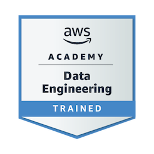

# 💫 About Me:
I’m a Computer Science student and full-stack developer focused on building modern, scalable web applications. My primary experience is with JavaScript, React, Next.js, and Node.js, complemented by Python, FastAPI, REST APIs, and database-driven backend systems. I enjoy working across the stack—from designing responsive interfaces and integrating APIs to building real-time features and developing reliable backend services. I’m particularly interested in frontend engineering, full-stack architecture, and building practical software that solves real-world problems. 

## 🌐 Socials:
  

# 💻 Tech Stack:
             
# 📊 GitHub Stats:
 
 

## ☁️ AWS Certifications

  

  

